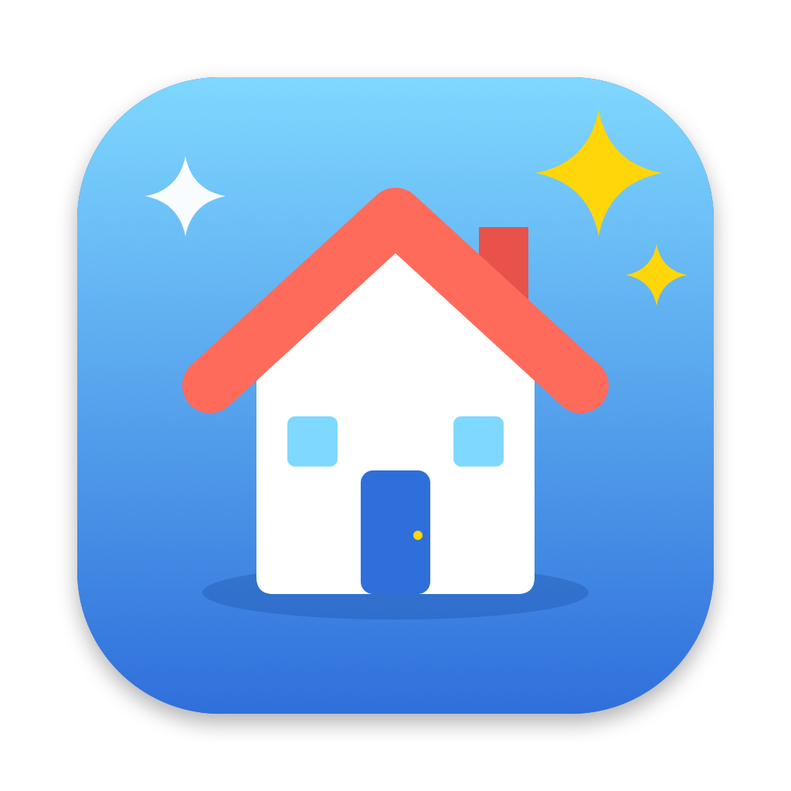

# HouseCleaning



A macOS app that finds files in `~/Library` left behind by apps that are no longer installed. It lists them for review and moves the ones you confirm to the Trash.

## What counts as "in use"

- Default macOS apps (`/System/Applications`, `/System/Library/CoreServices`, Safari) and any `com.apple.*` data
- App Store apps
- Homebrew casks and formulae (`brew info --installed --json=v2`), including each cask's `zap` paths
- Any other app in `/Applications` or `~/Applications`, plus anything currently running

## What gets scanned

These folders under `~/Library`: Application Support, Caches, Preferences, Containers, Group Containers, Application Scripts, Saved Application State, Logs, HTTPStorages, WebKit, Cookies and LaunchAgents.

Each entry is matched by bundle ID first: exact match, then the app's own prefix, then the developer's prefix. If that fails, it's matched by app or package name.

- **High confidence:** the entry has a bundle ID that no installed app uses. These start pre-selected.
- **Uncertain:** the entry is a plain folder name with no match. These start unchecked, so check them before deleting.

Nothing is ever deleted outright. Confirmed items go to the Trash.

## Build and run

Requires macOS 14+ and the Swift toolchain (Command Line Tools are enough).

```sh
scripts/build-app.sh          # builds build/HouseCleaning.app
open build/HouseCleaning.app

swift test                    # matcher and Homebrew parsing tests
swift run HouseCleaning --list  # dry run: print what would be flagged
swift scripts/make-icon.swift   # regenerate Assets/AppIcon.icns
```

For complete results, grant **Full Disk Access** to HouseCleaning in System Settings → Privacy & Security. Without it, app containers can't be measured.

> Note: with only the Command Line Tools installed, SwiftUI's `@State` macro is unavailable. View state therefore lives in the `@Observable` `CleanupModel`.
